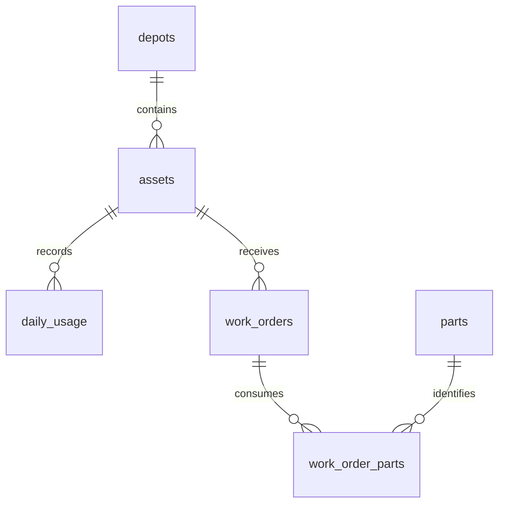

# Fleet Maintenance Analytics

[](https://github.com/Spandan-Deshpande/SQL-Project/actions/workflows/validate.yml)

A SQL portfolio project that turns equipment usage and service records into maintenance cost, availability, and service-planning reports.

**Dataset:** 200 simulated assets, four depots, 180 days, and 1,219 work orders. All data is synthetic. This is an independent learning project, not a Cummins system or a claim of operational savings.

## Questions answered

- Which depots spend the most per operating hour?
- Which failure categories account for the largest share of corrective maintenance cost?
- Which assets repeat the same fault within 30 days?
- Which assets are approaching their service interval?
- How does fleet utilization change over a seven-day window?
- How many input records are invalid or superseded?

## Results and implementation

| Measure | Reproduced value |
|---|---:|
| Raw usage records | 36,480 |
| Invalid records rejected | 120 |
| Duplicate records superseded | 360 |
| Clean asset-day observations | 36,000 |
| Work orders | 1,219 |
| SQL analysis exports | 8 |

See [generated results](reports/summary.md) and the CSV files in [reports](reports).
These are pipeline and dataset measurements, not improvements against a business baseline.

SQL handles validation, deduplication, joins, aggregation, CTEs, and window functions (`ROW_NUMBER`, `LAG`, `DENSE_RANK`, rolling and cumulative `SUM`). Python's standard library generates reproducible data and exports query results. SQLite keeps the project runnable without a database server.

## Run

Requires Python 3.10 or newer with SQLite window-function support. No third-party Python packages.

```sh
python run.py
python -m unittest discover -s tests -v
```

The script rebuilds an in-memory database, validates it, writes `build/fleet.db`, and regenerates reports. GitHub Actions runs the same commands and checks that reports reproduce exactly.

## Data model



Six core tables plus a raw staging table. Primary keys, foreign keys, uniqueness constraints, and checks enforce the model. Historical part prices are stored on order lines; money uses integer paise.

## Design decisions

- **Validate before deduplicating:** a later invalid observation cannot replace an earlier valid one.
- **Protect the reporting grain:** aggregate parts to one row per work order before joining usage. Multiple parts must not multiply operating hours or labour cost.
- **Separate availability from utilization:** availability excludes downtime from scheduled hours; utilization measures engine hours against scheduled hours.
- **Avoid false precision:** division by zero returns NULL. Assets with no observed preventive service are labeled `History incomplete`.
- **Reproducibility:** a fixed random seed and committed report outputs make changes inspectable.

## Assumptions and limits

Every asset has a 12-hour schedule on every day. There is at most one work order per asset/day, all downtime occurs within that day, and service completes at day's end. The generator ensures operating hours plus downtime never exceed scheduled hours. Seven-row rolling windows represent seven calendar days because calendar coverage is validated.

Service intervals and cost distributions are illustrative. The six-month window cannot establish lifetime reliability. This project performs descriptive analysis and service-threshold tracking, not failure prediction. A production version would need overlapping downtime reconciliation, meter resets, missing telemetry handling, and real maintenance policies.

## Project map

- `sql/01_schema.sql`: constraints and staging validation
- `sql/02_clean_usage.sql`: latest-valid-record deduplication
- `sql/03_views.sql`: safe reporting joins and audit counts
- `sql/queries/`: eight business analyses
- `tests/`: edge cases and reconciliation checks
- [Walkthrough](docs/WALKTHROUGH.md): explain the implementation and tradeoffs

## Context and authorship

Built as an original portfolio project with AI-assisted development and documentation. The business context was inspired by public descriptions of [Cummins PrevenTech](https://www.cummins.com/en-in/news/2023/09/22/improve-your-cost-production-cummins-preventechr), which discusses equipment availability and maintenance planning. No proprietary Cummins data or code is used.
